# SliceFS on NVMe 2.0: Key-Value and computational storage

Research and brainstorm, 2026-11-15. Method: 4 parallel researchers (KV command set, computational storage, other NVMe 2.0 features, prior art), one feasibility brief, 3 designs each attacked by a skeptical reviewer, and one final ranking.

## Summary

SliceFS should not build an NVMe Key-Value or computational-storage backend now. No drive that implements the standard command sets can be bought, macOS has no NVMe passthrough API, and the one cost a KV store would fix (many small object files) is fixed on every platform by the planned pack store.

The review found a more urgent problem that is not about NVMe: a commit does not fsync the stored objects, and log rotation then deletes the segments that held the fsynced write data. A power cut after a commit can lose data that an application fsynced. This is fixed first (see the plan below).

What to do instead: fix commit durability, ship pack files and the FastCDC + BLAKE3 store, measure the share of write time spent on chunking and hashing, and keep a small storage interface so that an NVMe backend stays cheap to add later. Watch Flexible Data Placement (FDP) and Zoned Namespaces (ZNS) for Linux servers; check once a year.

## What NVMe 2.0 offers

The specs exist and are ratified; drives and OS support are the gap. The limits below decide every design.

| Feature | What it gives | Hard limit for SliceFS | Linux access | macOS access | Devices to buy |
| --- | --- | --- | --- | --- | --- |
| [Key-Value command set](https://nvmexpress.org/specification/key-value-command-set-specification/) (rev 1.4, ratified 2026-07-31) | Store, Retrieve, Delete, Exist, List by key | Key at most 16 bytes (a BLAKE3-256 digest is 32); Retrieve returns the start of a value; per-key atomicity, no ordering across keys; List order is not defined | Raw passthrough only: `/dev/ngXnY` + io_uring passthrough, [xNVMe](https://www.mankier.com/1/kvs-store), SPDK; no kernel KV driver | None ([no NVMe passthrough API](https://developer.apple.com/forums/thread/773032)) | None found (Samsung [KV-SSD](https://github.com/OpenMPDK/KVSSD) prototypes used pre-standard commands) |
| Computational Programs + [Subsystem Local Memory](https://nvmexpress.org/wp-content/uploads/NVM-Express-Subsystem-Local-Memory-Specification-1.0a-2024.08.01-Ratified.pdf) | Run a program on the drive over data copied into device memory | Programs are device-specific; nothing runs BLAKE3 or FastCDC; results must match host hashing bit for bit | Passthrough only, no upstream framework | None | No standard device; vendor CSDs ([ScaleFlux](https://www.storagenewsletter.com/2024/08/09/scaleflux-csd5000-nvme-ssd-series-up-to-123tb-physical-capacity-and-up-to-256tb-logical-capacity-with-fx5016-pcie-5-controller-for-ai-era/) compression; [SmartSSD](https://www.techradar.com/pro/samsung-and-amd-made-a-revolutionary-ssd-together-then-it-was-left-to-wither-in-the-shadows-and-nobody-knows-exactly-why) discontinued) |
| [Flexible Data Placement](https://semiconductor.samsung.com/news-events/tech-blog/nvme-fdp-a-promising-new-ssd-data-placement-approach/) (FDP) | Hints that group writes by lifetime (log, packs, metadata) to cut write amplification | Needs a raw namespace or a file system that passes hints | Passthrough; block-layer support from about [Linux 6.16](https://kernelnewbies.org/Linux_6.16) | None | Some datacenter drives |
| [Zoned Namespaces](https://zonedstorage.io/docs/introduction/zns) (ZNS) | Append-only zones; the host does GC | SliceFS must own allocation and GC on the raw device | Kernel zoned block support, f2fs, btrfs | None | Few datacenter drives |
| Copy command | Copy blocks inside the drive (GC compaction without host round trips) | Linux copy offload [not merged](https://lwn.net/Articles/1069674/) | Passthrough only | None | Many drives report it |
| Atomic write units (AWUPF) | A write of up to N blocks never tears | Size differs per drive; must be read at mount | Reported by the drive | Not exposed | Most drives (often 1 block) |

The claim that no KV or compute drive can be bought rests on a few searches: medium confidence.

## Where each feature could fit in SliceFS

Only two NVMe ideas fit SliceFS today, and neither needs a special drive: writing the root record inside one atomic block, and freeing space with deallocate (TRIM), which the host file system already does.

| SliceFS part | Today | Candidate feature | Verdict |
| --- | --- | --- | --- |
| Chunk store | One file per ~4 KB object in `vt0/`; moving to FastCDC 8 KiB chunks in pack files | KV namespace (key = digest) | No: 16-byte keys, no drives, no macOS; packs fix the small-files cost everywhere |
| Dedup lookup (chunk index) | Object exists by name | KV Exist | No: same reasons; a host index with a filter is cheaper |
| Write log | Segment log, CRC32C per record, rotated at each commit | FDP hint (short-lived data), atomic writes | Later, Linux servers only (FDP) |
| Root record | One object + a WAL record | Atomic write units: a 2-slot root of at most 512 bytes with a CRC | Yes, on every platform |
| Pack files | Planned | FDP or ZNS placement by lifetime; Copy for compaction | Watch: needs a raw namespace and a drive |
| GC mark and sweep | Host, multi-threaded, online | Computational storage near the data; Copy | No: no device runs it, and the mark is not the hot cost |
| Chunking + hashing | Host CPU (FastCDC + BLAKE3: 530 to 910 MB/s on one core, #17) | Computational Programs | No: no device runs BLAKE3/FastCDC; the gain is capped by the unmeasured share of write time |
| Compression | Planned (host zstd/lz4) | Drive transparent compression | Not needed |
| Freed space | Files deleted | Deallocate (TRIM) | Already used through the host file system |

## Designs considered

All three designs failed review: none can be built and tested without hardware that is not for sale, and none beats the portable pack store on the measured costs. Scores are 1 to 5 (cost: 5 = very expensive).

| Design | Verdict | Feasibility | Value | Cost | Why |
| --- | --- | --- | --- | --- | --- |
| C: standard NVMe features (FDP/ZNS/Copy under a portable pack layer, 2-slot root) | Build the portable pack layer after a redesign; watch the NVMe layer | 2 | 2 | 4 | Packs and the atomic root help on every drive, macOS included. FDP, ZNS and Copy need Linux 6.16+, a raw namespace and a drive; their only gain (write amplification) cannot be measured in CI. Review found that the location map rewrites almost every leaf per commit, fsync would flush packs, and GC can delete packs that readers still use. |
| B: computational-storage offload (chunk + hash, scrub, GC mark on the drive) | Reject | 1 | 2 | 5 | No standard drive, none runs BLAKE3/FastCDC, no emulator, no macOS. The gain is at most 1/(1 − p), with p (the hashing share of write time) unmeasured. Keep: measure p, a batched chunk-and-hash trait, a host scrub. |
| A: NVMe KV chunk store | Reject | 1 | 1 | 4 | No drive or emulator. 16-byte keys force truncated digests plus a header check on every dedup hit. Review found a race between the GC sweep and a dedup hit (data loss), a 16 GB key journal with no layout, and no host-side root fsync. Helps only the small-files cost, which packs fix everywhere. |

## Emulation changes the verdicts

Every design can be built and tested on Linux without a drive: two emulators cover the missing hardware. The design reviews said "no emulator"; that was wrong.

| Emulator | Emulates | Fit for SliceFS | Limits |
| --- | --- | --- | --- |
| [NVMeVirt](https://github.com/snu-csl/nvmevirt) ([FAST 2023](https://www.usenix.org/conference/fast23/presentation/kim-sang-hoon)) | A Linux kernel module that presents a virtual NVMe device: conventional SSD (FTL timing model), ZNS SSD, KV SSD (hash index, SNIA KV API); a computational-storage backend is listed as done in a [2024 talk](https://files.futurememorystorage.com/proceedings/2024/20240807_SSDT-203-1_Shim.pdf) | Design A (KV chunk store) and Design B (compute offload) can be prototyped and tested in a Linux CI VM; write amplification can be estimated with its FTL model | One device type per build; tested on Linux 5.15; out of tree ([mainline proposal, 2024](https://lists.infradead.org/pipermail/linux-nvme/2024-February/045447.html)); timing is a model, not a real drive |
| [QEMU NVMe emulation](https://qemu.readthedocs.io/en/master/system/devices/nvme.html) | NVMe 1.4 controller with FDP (`fdp=on`, reclaim unit handles), ZNS, Simple Copy | Design C (FDP/ZNS placement, Copy for compaction) can run in CI | No KV command set; no FTL, so write amplification cannot be measured |

Revised verdicts:

- **C (standard NVMe):** still the best fit; the FDP/ZNS/Copy layer can now get CI tests in QEMU. Build the portable pack layer first.
- **A (KV chunk store):** from reject to **prototype possible** in NVMeVirt. Value stays low (16-byte keys; packs fix the small-files cost), so do it only as an experiment after packs ship.
- **B (compute offload):** from reject to **experiment possible** in NVMeVirt's computational-storage backend. Still gated on measuring p, the hashing share of write time.

## Plan

```mermaid
flowchart LR
  subgraph S1["1 · Now (next 1 to 2 milestones)"]
    a1[Crash test: commit + rotation] --> a2[Fix commit durability]
    a3[BlockStore: sync, put_batch]
    a4[fsync syncs only the log]
    a5[Measure hashing share p]
    a6[FastCDC + BLAKE3, pack format]
  end
  subgraph S2["2 · Portable packs (after stage 1)"]
    b1[Redesign the location map]
    b2[PackStore on files, all OS]
    b3[2-slot root, 512 B, CRC]
    b4[Batched chunk-and-hash trait]
    b5[Host content scrub]
  end
  subgraph S3["3 · Watch only (check once a year)"]
    c1[FDP / ZNS backend]
    c2[NVMe Copy: Linux merge]
    c3[KV store: drive + emulator]
    c4[Compute offload: p above 0.3]
  end
  S1 --> S2
  S2 -->|"Gate G1: a drive in hand, a Linux server user, write amplification above 1.5"| S3
```

Stage 1 is work in the SliceFS codebase now; it pays off on every platform. Stage 3 items start only when their condition is met.

## Risks

- Commit durability: objects in `vt0/` are never fsynced, and log rotation deletes the segments that hold fsynced write data. A power cut after a commit can lose that data. Found by reading the code; a crash test must confirm it.
- Syncing about 262k small objects per GiB makes the durability fix slow until packs ship.
- A copy-on-write location map keyed by random digests rewrites almost every leaf at each commit (the ZFS dedup-table problem), on every platform.
- If fsync flushes packs, a file close on macOS costs about 4 `F_FULLFSYNC` calls instead of 1.
- Emulators (NVMeVirt, QEMU) model the commands, not real drive timing or firmware bugs; results from them need a real drive before any default changes.
- macOS can never use these NVMe features, so any NVMe backend means two storage paths to maintain.

## Open questions

- What is p, the share of write time spent on chunking and hashing?
- Does a crash test confirm the commit durability bug on Linux and on macOS?
- What write amplification does SliceFS cause on ext4, xfs and APFS?
- What atomic write size (AWUPF) do target drives report?
- Are 128-bit truncated hashes safe enough for dedup, if KV is ever revisited?
- Is a completed KV Store durable before Flush?
- Do file systems pass FDP placement hints for buffered writes?
- What permissions does a non-root FUSE daemon need for `/dev/ngXnY`?

## Sources

Specifications and standards:

- [NVMe Key-Value Command Set](https://nvmexpress.org/specification/key-value-command-set-specification/), [revision 1.4 (2026-07-31)](https://nvmexpress.org/wp-content/uploads/NVM-Express-Key-Value-Command-Set-Specification-Revision-1.4-Ratified-2026.07.31.pdf), [revision 1.0e (2024-07-01)](https://nvmexpress.org/wp-content/uploads/NVM-Express-Key-Value-Command-Set-Specification-1.0e-2024.07.01-Ratified.pdf)
- [NVMe Subsystem Local Memory 1.0a](https://nvmexpress.org/wp-content/uploads/NVM-Express-Subsystem-Local-Memory-Specification-1.0a-2024.08.01-Ratified.pdf), [UNH-IOL Computational Programs conformance v24](https://www.iol.unh.edu/sites/default/files/testsuites/nvme/v24/UNH-IOL_Computational_Programs_Conformance_v24.0_2025.07.29.pdf)
- [SNIA NVMe KV Q&A](https://snia.org/blog/2020/nvme-key-value-standard-qa), [SNIA KV API](https://snia.org/keyvalue), [SNIA Computational Storage](https://www.snia.org/computational)
- [Zoned storage: ZNS](https://zonedstorage.io/docs/introduction/zns), [Samsung on FDP](https://semiconductor.samsung.com/news-events/tech-blog/nvme-fdp-a-promising-new-ssd-data-placement-approach/)

Operating system support:

- Linux: [ng device for unknown command sets](https://github.com/torvalds/linux/commit/eb867ee995bd687154adb77bf7fda05c7d16fd9d), [io_uring passthrough](https://github.com/torvalds/linux/commit/456cba386e94f22fa1b1426303fdcac9e66b1417), [Linux 6.11](https://kernelnewbies.org/Linux_6.11), [6.13](https://kernelnewbies.org/Linux_6.13), [6.16](https://kernelnewbies.org/Linux_6.16), [copy offload series (LWN)](https://lwn.net/Articles/1069674/), [linux-nvme on KV (2023)](https://lists.infradead.org/pipermail/linux-nvme/2023-August/041702.html), [linux-nvme on KV (2022)](https://lists.infradead.org/pipermail/linux-nvme/2022-February/030031.html)
- Libraries: [SPDK v26.05](https://github.com/spdk/spdk/releases/tag/v26.05), [SPDK v26.09](https://github.com/spdk/spdk/releases/tag/v26.09), [xNVMe kvs-store](https://www.mankier.com/1/kvs-store), [OpenMPDK KVSSD](https://github.com/OpenMPDK/KVSSD)
- macOS: [Apple: no NVMe passthrough API](https://developer.apple.com/forums/thread/773032), [MacVFN](https://github.com/SamsungDS/MacVFN)

Research and products:

- [Samsung KV-SSD (SYSTOR 2019)](https://www.systor.org/2019/slides/S8P1%20Towards%20Building%20a%20High-performance,%20Scale-in%20Key-value%20Storage%20System.pdf), [KV-SSD: What Is It Good For? (DAC 2021)](https://par.nsf.gov/servlets/purl/10320100), [PinK (USENIX ATC 2020)](https://files.usenix.org/s3fs-public/cdn/atc20-im_0.pdf), [KEVIN (OSDI 2021)](https://www.usenix.org/conference/osdi21/presentation/koo)
- [CAFTL (FAST 2011)](http://www.usenix.org/events/fast11/tech/full_papers/Chen.pdf), [StreamDedup (TRETS 2026)](https://htor.inf.ethz.ch/publications/img/2026_jiayong_streamdedup.pdf), [FastCDC (USENIX ATC 2016)](https://files.usenix.org/s3fs-public/cdn/atc16-paper-xia.pdf), [BLAKE3 spec](https://raw.githubusercontent.com/BLAKE3-team/BLAKE3-specs/master/blake3.pdf)
- [AMD: ZFS on SmartSSD (SNIA 2022)](https://www.snia.org/sites/default/files/PM-Summit/2022/PMCS22-Malyala-Vaishnavi-Nagula-File-System-Acceleration-Using-CS.pdf), [TechRadar on SmartSSD (2025)](https://www.techradar.com/pro/samsung-and-amd-made-a-revolutionary-ssd-together-then-it-was-left-to-wither-in-the-shadows-and-nobody-knows-exactly-why), [ScaleFlux CSD 5000 (2024)](https://www.storagenewsletter.com/2024/08/09/scaleflux-csd5000-nvme-ssd-series-up-to-123tb-physical-capacity-and-up-to-256tb-logical-capacity-with-fx5016-pcie-5-controller-for-ai-era/)
